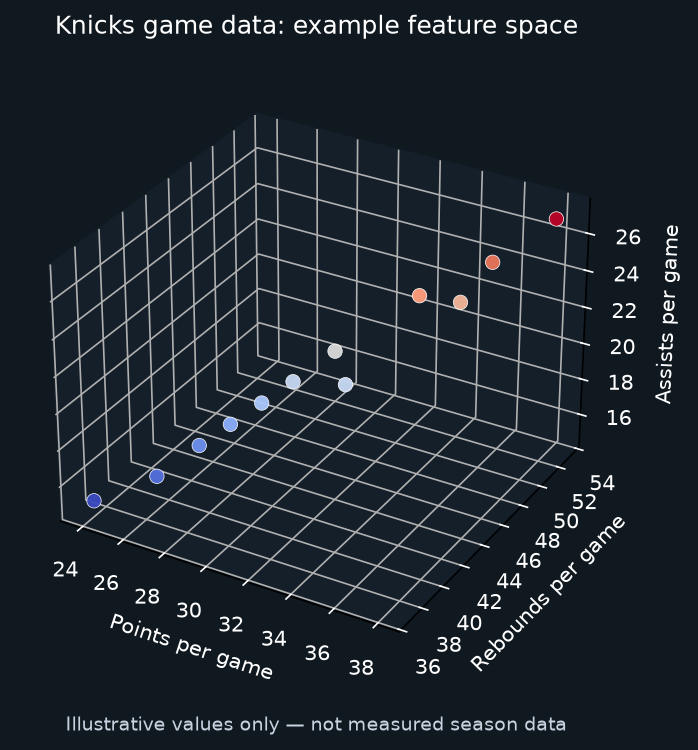

# NYK_Learning



*Illustrative feature space only; values are examples, not historical Knicks statistics.*

Everything NY Knicks just because why not.

A Knicks data-engineering and ML learning project: historical statistics, structured game observations, reproducible datasets, and experiments grounded in explicit evidence.

## Current milestone

The first implementation is a **team-game ETL foundation**:

- Preserve raw JSON responses and SHA-256 hashes.
- Validate game identifiers, counts, scores and source schemas.
- Join Knicks games to opponent scores.
- Build versioned CSV, SQLite and optional Parquet releases.
- Track season coverage and retain old snapshots when corrections arrive.
- Test the workflow with invented games before contacting a live API.

No real historical dataset is included. The sample games are synthetic, not actual Knicks results. Player history, game-observation ingestion and ML experiments are later milestones.

## Start here

Read [the local setup manual](docs/START_HERE.md).

From the repository root in your Python 3.11+ environment:

```bash
python3 -m venv .venv-knicks
source .venv-knicks/bin/activate
python -m pip install -e .
python -m unittest discover -s tests -v
knicks ingest --input fixtures/league-demo.json --synthetic --season 2024-25 --root data/demo
knicks build --root data/demo --expected config/expected-demo.csv
```

Install `python -m pip install -e '.[columnar]'` and add `--parquet` to the build command for Parquet. GitHub Actions installs this extra and runs the same synthetic pipeline. Initial dependency ranges are not a fully locked environment; record exact versions after a successful local installation.

## Project map

| Directory | Purpose |
|---|---|
| `src/knicks_history` | CLI, source adapter, validation and dataset builds |
| `fixtures` | Explicitly synthetic teaching data |
| `tests` | Replay, corrections, nulls, integrity and failure tests |
| `config` | Expected fixture counts and historical review checklist |
| `sql` | Consumer queries and lagged feature example |
| `scripts` | Sequential backfill, alternate source import and release staging |
| `docs` | Setup and dataset card |
| `data` | Generated local snapshots/releases; ignored by Git |

## Verification

The standard-library tests were rerun while importing this starter: 19 passed, with the optional Parquet test skipped in the preparation environment. Check Actions for GitHub's Parquet integration result. Live NBA requests and historical completeness have not been validated.

This repository is the public project page. A separate GitHub Pages website is not configured by this change.

## Historical team game data

The local season archive is generated and ignored by Git. To load regular seasons from 2017–18 through 2025–26 from the published team game logs source, install the optional columnar dependency and run:

```bash
python -m pip install -e '.[columnar]'
python scripts/import_team_logs.py --start 2018 --end 2026 --root data/live
knicks build --root data/live --parquet
```

The source uses the season ending year (`2018` means `2017-18`). The importer filters game IDs to regular-season games, preserves source provenance, and validates each season through the same archive pipeline as the NBA Stats adapter. Counts reflect NBA schedule changes, including 66 games in 2019–20 and 72 in 2020–21. Confirm source permissions and historical accuracy before redistributing exports.

## License

Original code and invented fixture: MIT, see [LICENSE](LICENSE). This does not grant redistribution rights for third-party NBA data. Document source permissions and historical coverage before publishing real extracts.
